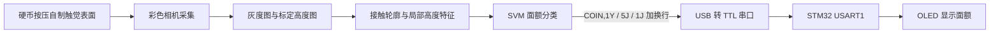

# 基于视触觉传感的硬币面额识别与 STM32 OLED 显示

本项目以 [9DTact](https://github.com/linchangyi1/9DTact) 视觉触觉传感器开源项目为基础，面向课设实现硬币触觉采集、形貌分析、面额分类，并把识别结果通过串口发送给 STM32，在 OLED 上显示。

> 这是一个仍在开发和验证中的课设项目。实时识别、串口发送和 STM32 OLED 显示代码已经接入；不同硬币、不同位置和压力下的稳定性，以及整机串口链路，仍需要继续实测。交叉验证成绩不能代替独立样本测试。

## 项目流程



相机是彩色相机；当前 9DTact 形状重建流程将相机帧转成灰度图，再根据参考帧和标定数据计算高度图。灰度图是中间输入，`DepthMap` 和 3D 点云才用于观察重建形貌。

## 当前已完成

- 使用自制触觉传感器和摄像头运行 9DTact 形状重建流程。
- 采集程序支持选择训练集或验证集、选择硬币面额，并保存灰度图、带轮廓的深度图和高度矩阵。
- 实时深度图叠加接触轮廓；显示路径加入 3×3 中值去噪、小连通区域清理及 5 帧时间中值平滑。平滑只用于显示，保存的高度 `.npy` 保留当前帧原始高度数据。
- 高度图分析脚本递归读取类别目录，计算接触轮廓、尺寸、表面起伏和剖面等特征，并输出 CSV。
- 分类器使用接触轮廓和局部浮雕高度特征，经标准化后用 RBF-SVM 训练；训练脚本输出分层交叉验证结果并保存模型。
- 支持单张高度图预测，以及等待接触稳定后进行实时多数投票识别。
- Python 实时识别脚本在结果达到投票阈值时发送串口数据；STM32 USART1 接收后按面额更新 OLED。

## 目录说明

```text
shape_reconstruction/
├── _1_Camera_Calibration.py       # 相机标定
├── _2_Sensor_Calibration.py       # 传感器深度标定
├── _3_Shape_Reconstruction.py     # 采集、二维/三维显示与数据保存
├── analyze_height_maps.py         # 分析高度图并生成特征 CSV
├── train_shape_classifier.py     # 训练面额分类器
├── predict_coin.py                # 单张 .npy 离线预测
├── recognize_coin_live.py         # 摄像头实时识别并通过串口发送
├── camera.py / sensor.py          # 相机、传感器和高度图处理
├── visualizer.py                  # Open3D 点云显示
├── shape_config.yaml              # 相机和重建参数
├── calibration/                   # 相机/传感器标定文件
└── results/                       # 采集数据、CSV 和训练模型（本地生成）

stm32/
├── project.uvprojx                # Keil 工程
├── User/main.c                    # 串口包解析结果与 OLED 显示
└── Hardware/Serial.c              # USART1 初始化与接收中断
```

## 环境准备

项目原始 9DTact 代码以 Python 3.8 为基准。Windows 下建议在 PyCharm 中选择 Python 3.8 解释器，并在该解释器的终端安装硬币识别所需依赖：

```powershell
python -m pip install numpy==1.23.5 opencv-python==4.8.0.76 PyYAML==6.0.1 open3d==0.13.0 scikit-learn==1.3.2 joblib pyserial
```

请确认 PyCharm 运行脚本使用的解释器与安装依赖的解释器相同。根目录的 `requirements.txt` 包含原项目的 ROS 依赖；在普通 Windows 硬币识别流程中不需要安装整份 ROS 依赖。

本项目需要本机可用的相机标定和深度标定文件。`shape_reconstruction/shape_config.yaml` 中的 `camera_channel`、分辨率、标定目录等参数应按实际设备调整。首次搭建或更换相机/触觉表面后，应检查对焦与标定；不要用其他传感器的标定文件替代。

## 数据采集与重建

从项目根目录进入脚本目录：

```powershell
cd shape_reconstruction
python _3_Shape_Reconstruction.py
```

程序启动后按提示操作：

1. 传感器空载并稳定，在参考图窗口按 `y` 设置参考帧。
2. 选择数据用途：`1` 为训练集，`2` 为独立验证集。
3. 选择类别：`1` 为 `1角`，`2` 为 `1元`，`3` 为 `5角`。
4. 硬币平整接触并保持稳定后，在 `RawImage_GRAY` 或 `DepthMap` 窗口按 `s` 保存；按 `q` 退出。

数据分别保存到：

```text
shape_reconstruction/results/shape_dataset/<面额>/
shape_reconstruction/results/shape_validation/<面额>/
```

每次采集会生成：

- `*_gray.png`：相机灰度帧。
- `*_depth.png`：显示用深度图，包含红色接触轮廓。
- `*_height.npy`：高度矩阵原始数据，供分析、训练或预测使用。

采集时应让类别目录与真实面额一致。训练样本和验证样本分开放置；验证集不要用于训练。

## 分析和训练

完成或补充训练集采集后，在 `shape_reconstruction` 目录依次运行：

```powershell
python analyze_height_maps.py
python train_shape_classifier.py
```

分析脚本递归读取 `results/shape_dataset/` 下各类别的 `*_height.npy`，并生成带类别标签的 `results/shape_dataset/shape_height_features.csv`。分类器从高度矩阵重新提取轮廓和局部浮雕特征，使用分层交叉验证评估，并把最终模型保存为：

```text
results/shape_dataset/shape_classifier.joblib
```

每次训练集新增、删除或改名后，都要重新运行分析脚本和训练脚本。交叉验证只评估当前数据；同一枚硬币的连续按压样本很相似时，成绩可能偏高。应使用未参与训练、最好是重新放置或另一枚硬币采集的验证样本检查泛化效果。

## 离线与实时识别

### 单张高度图预测

```powershell
python predict_coin.py
```

按提示输入一张未训练的 `*_height.npy` 文件路径。该脚本需要先存在匹配的 `shape_classifier.joblib`。

### 摄像头实时识别与串口发送

先打开 `recognize_coin_live.py`，将串口配置行中的 `COM5` 改为 USB 转 TTL 模块在 Windows 设备管理器中的实际 COM 号。关闭占用该端口的串口助手，然后运行：

```powershell
python recognize_coin_live.py
```

程序空载参考帧设置完成后，放上硬币并保持不动约 2 秒；随后取 15 帧投票，至少 10 帧一致时才输出并发送一次结果。结果不稳定时不会发送。松开硬币后可识别下一枚。

## STM32 与 OLED 串口协议

Keil 工程位于 `stm32/project.uvprojx`。当前代码使用 STM32F103C8 的 USART1，配置为 **9600 baud、8 数据位、无校验、1 停止位（9600 8N1）**：

- STM32 `PA10 / USART1_RX` 接 USB 转 TTL 模块的 `TX`。
- STM32 `GND` 与 USB 转 TTL 模块 `GND` 共地。
- 使用 3.3 V TTL 电平；不要把相机 USB 设备当成 STM32 串口。
- `PA9 / USART1_TX` 当前不是 Python 单向发送所必需的连接。

Python 发送 ASCII 文本包，末尾为换行符 `\n`：

| 面额 | Python 发出的字节 | STM32 字符串匹配值 |
|---|---|---|
| 1 元 | `COIN,1Y\n` | `COIN,1Y` |
| 5 角 | `COIN,5J\n` | `COIN,5J` |
| 1 角 | `COIN,1J\n` | `COIN,1J` |

STM32 接收中断在收到 `\n` 后完成数据包，主循环按字符串匹配并调用 OLED 显示。串口端到端是否成功，仍需在实际 USB 转 TTL、STM32 和 OLED 硬件上验证。

## 已知限制与后续工作

- 自制黑色胶层的厚度、硬度、弹性和光学性质会影响浅浮雕形变；显示增强无法恢复传感器没有采到的细节。
- 手动按压力度、位置、倾斜和硬币正反面会带来变化，需要用多次独立放置的样本验证。
- 当前模型样本量有限，特别要关注 1 角与其他面额的混淆；报告中的交叉验证准确率不等于真实部署准确率。
- 当前 STM32 OLED 文字为英文简写；中文字体、结果置信度/无效包处理以及完整串口稳定性仍可继续完善。
- Git 忽略规则会排除本地 Python 环境、采集结果和模型文件。仓库当前包含 `sensor_1` 标定文件；新电脑上要先确认它与实际传感器匹配。采集数据和训练模型需自行重新生成或单独备份。

## 上游项目与许可

本项目基于 [9DTact 开源项目](https://github.com/linchangyi1/9DTact) 的相机、触觉重建和可视化代码进行课设扩展。请保留并遵守仓库现有 `LICENSE` 文件及上游项目的许可与署名要求。
