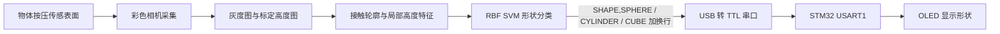

# 基于视触觉传感的物体形状识别与 STM32 OLED 显示

本项目基于 [9DTact](https://github.com/linchangyi1/9DTact) 视触觉传感器开源项目，使用自制触觉表面和摄像头采集按压形变，识别球、圆柱和正方体，并通过串口将稳定识别结果发送至 STM32 OLED。

> 项目仍在开发和验证中。交叉验证结果不代表独立样本准确率；串口链路与 OLED 显示需要在实际硬件上验证。

## 流程



相机帧被转换为灰度图，再根据参考帧和深度标定数据计算高度图。分类器使用高度矩阵中的接触轮廓和局部高度分布，不直接识别普通 RGB 照片，也不重建未被传感器采到的物体表面。

## 主要脚本

```text
shape_reconstruction/
├── _1_Camera_Calibration.py        # 相机标定
├── _2_Sensor_Calibration.py        # 传感器深度标定
├── _3_Shape_Reconstruction.py      # 采集形状样本、显示并保存图像/高度图
├── analyze_height_maps.py          # 分析训练集高度图并生成标签 CSV
├── train_shape_classifier.py       # 训练球/圆柱/正方体分类器及输出交叉验证误判清单
├── validate_shape_classifier.py    # 批量识别验证集并生成预测/误判 CSV
├── recognize_shape_live.py         # 摄像头实时识别并向 STM32 发送结果
├── camera.py / sensor.py           # 相机、传感器和高度图处理
├── visualizer.py                   # Open3D 点云显示
├── shape_config.yaml               # 相机和重建参数
└── results/                        # 本地采集数据、CSV 和模型

stm32/
├── project.uvprojx                 # Keil 工程
├── User/main.c                     # 解析形状串口包并更新 OLED
└── Hardware/Serial.c               # USART1 初始化和接收中断
```

## 环境

项目原始 9DTact 代码以 Python 3.8 为基准。请在 PyCharm 选择项目使用的解释器，并在该解释器中安装依赖：

```powershell
python -m pip install numpy opencv-python PyYAML open3d scikit-learn joblib pyserial
```

根目录 `requirements.txt` 包含原项目的 ROS 依赖；普通 Windows 形状识别流程不需要安装整份 ROS 依赖。请确认 `shape_config.yaml` 中的相机编号、分辨率及标定目录与实际设备相符。

## 采集数据

```powershell
cd shape_reconstruction
python _3_Shape_Reconstruction.py
```

按提示选择训练集或验证集，再选择类别：`1` 球、`2` 圆柱、`3` 正方体。物体放稳后，在 `RawImage_GRAY` 或 `DepthMap` 窗口按 `s` 保存，按 `q` 退出。

训练集保存到 `shape_reconstruction/results/shape_dataset/<类别>/`；独立验证集保存到 `shape_reconstruction/results/shape_validation/<类别>/`。每次按 `s` 会保存：

- `*_gray.png`：相机灰度帧。
- `*_depth.png`：带轮廓的深度显示。
- `*_depth_plain.png`：不带轮廓的深度显示。
- `*_height.npy`：高度矩阵，供训练和预测使用。

训练集和验证集必须分开。验证集样本不要参与训练；独立验证时使用重新放置采集的新样本。

## 训练

```powershell
python analyze_height_maps.py
python train_shape_classifier.py
```

分析脚本扫描 `results/shape_dataset/<类别>/` 并生成 `shape_height_features.csv`。训练脚本从高度矩阵提取 6 个轮廓特征和 32 个局部高度特征，使用标准化 RBF SVM，输出分层交叉验证指标、混淆矩阵和逐样本预测。

模型保存为 `results/shape_dataset/shape_classifier.joblib`。交叉验证误判清单保存在 `shape_cv_misclassified.csv`，所有折外预测保存在 `shape_cv_predictions.csv`。

## 验证集识别

模型训练完成后运行：

```powershell
python validate_shape_classifier.py
```

脚本读取 `results/shape_validation/<类别>/*_height.npy`，用父目录名称作为真实标签，输出准确率、分类报告和混淆矩阵，并生成 `validation_predictions.csv` 与 `validation_misclassified.csv`。如果模型缺少验证集中的类别，请先用当前类别重新训练。

## 摄像头实时识别

先在 `recognize_shape_live.py` 中将 `SERIAL_PORT = "COM5"` 改为 USB 转 TTL 模块在设备管理器中显示的端口，再运行：

```powershell
python recognize_shape_live.py
```

启动初始化相机时保持传感器空载。放上物体并保持不动约 2 秒，程序再用 15 帧投票；至少 10 帧一致才显示并发送结果。低一致性结果不会发送。松开物体后可识别下一个。

## STM32 串口协议

Keil 工程位于 `stm32/project.uvprojx`。USART1 配置为 9600 baud、8 数据位、无校验、1 停止位（9600 8N1）。连接 USB 转 TTL 的 TX 到 STM32 PA10（USART1_RX），双方 GND 共地，使用 3.3 V TTL 电平。

Python 发送 ASCII 文本包，末尾为 `\n`：

| 类别 | Python 数据包 | STM32 匹配字符串 |
|---|---|---|
| 球 | `SHAPE,SPHERE\n` | `SHAPE,SPHERE` |
| 圆柱 | `SHAPE,CYLINDER\n` | `SHAPE,CYLINDER` |
| 正方体 | `SHAPE,CUBE\n` | `SHAPE,CUBE` |

STM32 接收中断收到换行符后置位 `Serial_RxFlag`，主循环解析字符串并更新 OLED。实际硬件串口与屏幕结果需自行联机确认。

## 限制

- 手动按压的位置、方向和力度会改变传感器形变；采集数据应覆盖计划使用的摆放方式。
- 自制胶层的厚度、硬度、弹性和光学性质会影响重建效果；更换传感表面后应重新检查标定。
- 同一批次连续按压样本可能非常相似，随机交叉验证结果可能偏高；应使用独立采集的验证集评估泛化能力。
- Git 忽略规则排除本地 Python 环境、采集结果和模型；数据与模型需自行备份。

## 上游项目与许可

本项目基于 [9DTact 开源项目](https://github.com/linchangyi1/9DTact) 的相机、触觉重建和可视化代码进行扩展。请遵守仓库现有 `LICENSE` 文件及上游项目的许可和署名要求。
